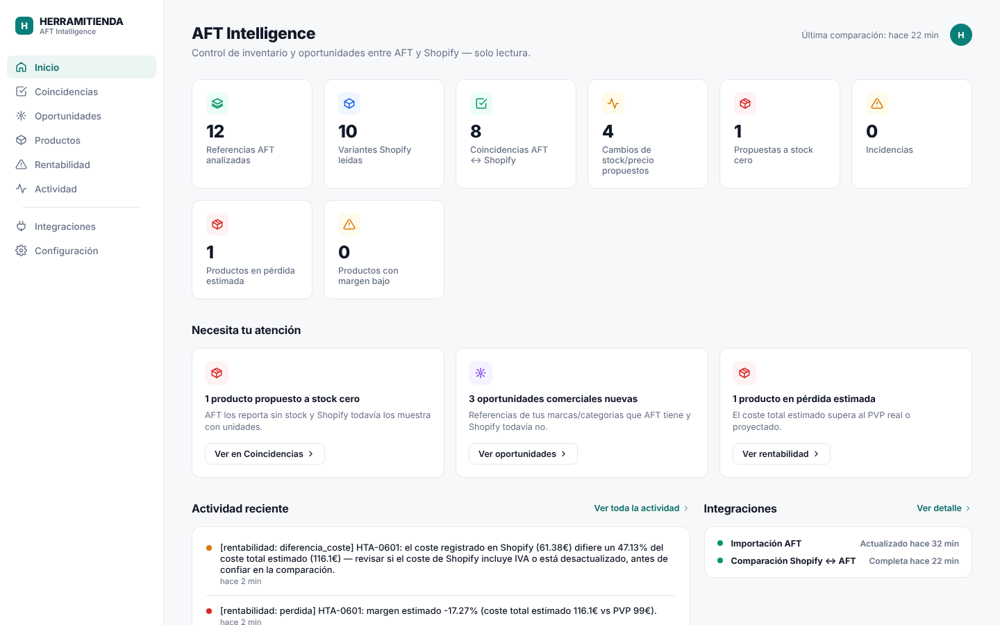
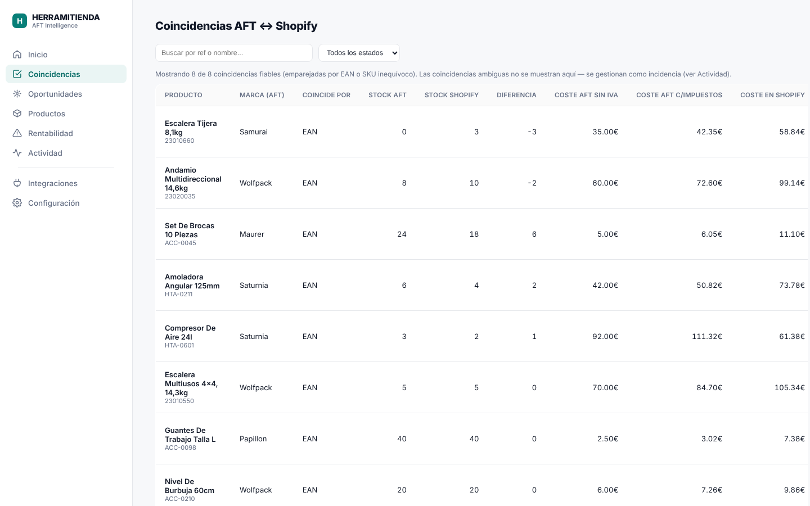
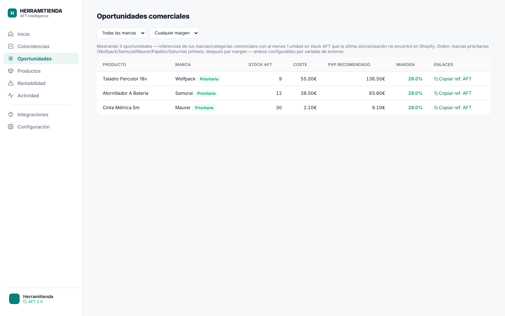
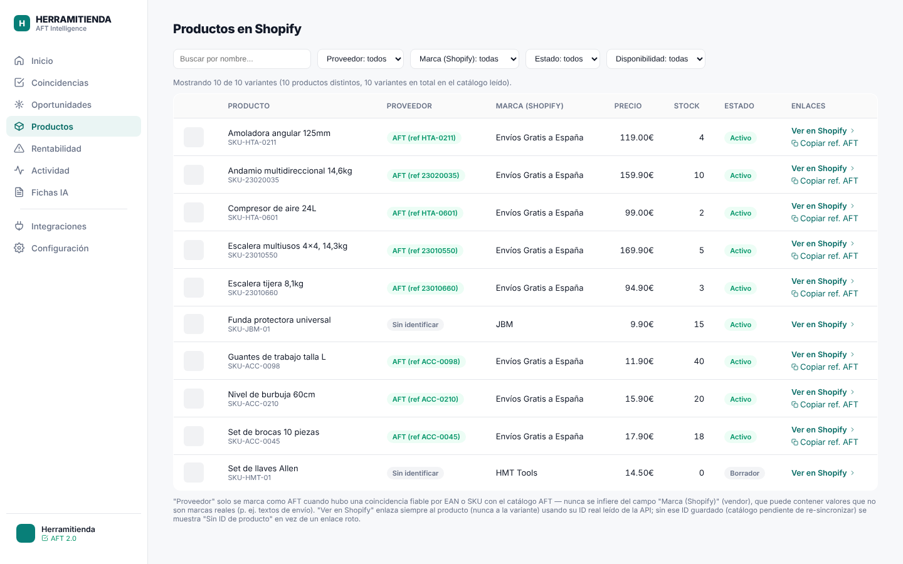
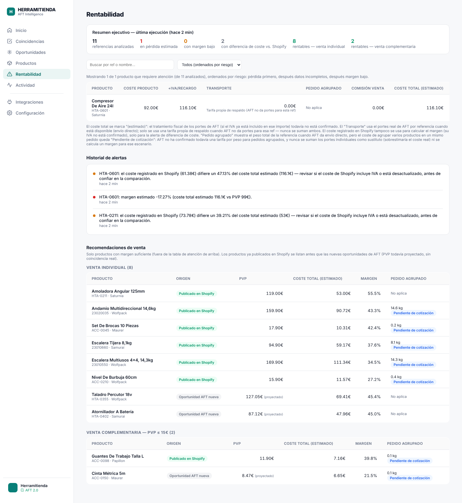
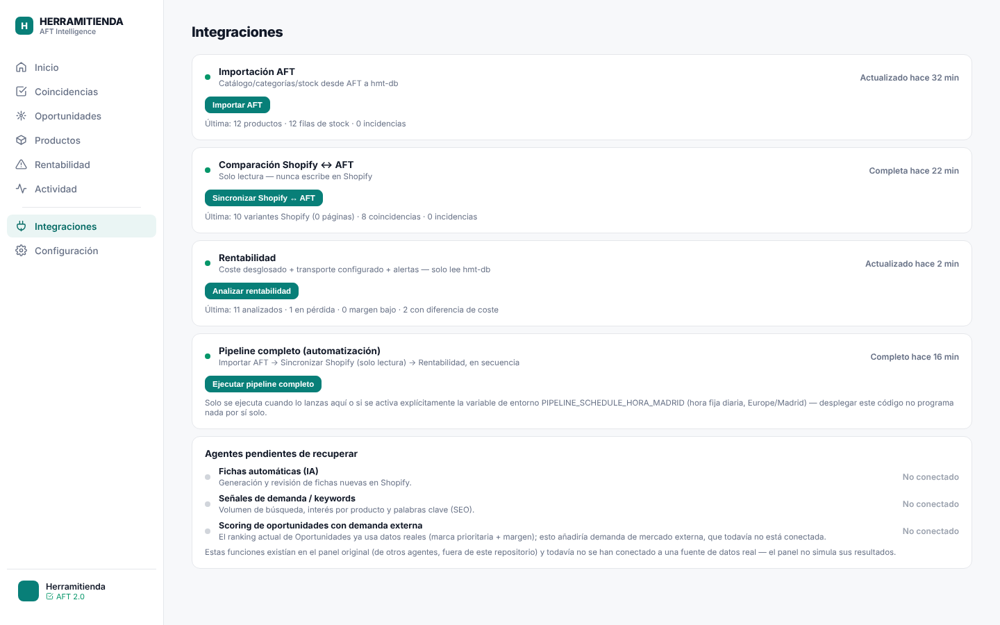
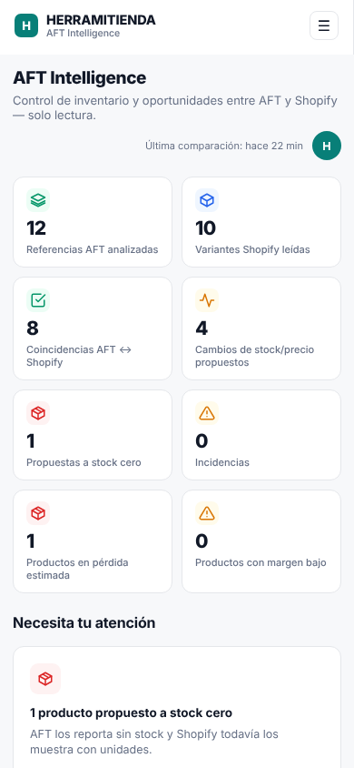
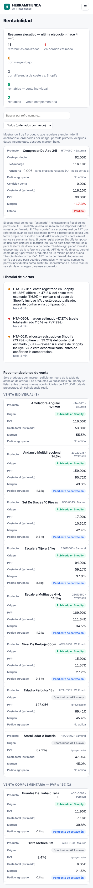

# AFT Intelligence 2.0

Sistema de inteligencia de inventario y rentabilidad para **Herramitienda**: concilia el catálogo/stock/coste del proveedor **AFT** con el catálogo real de **Shopify**, calcula el margen real por referencia (impuestos, portes y comisiones incluidos) y prioriza oportunidades comerciales — todo auditable desde un panel propio, con base de datos independiente y sin ninguna escritura hacia Shopify.

---

## 1. Presentación ejecutiva y problema empresarial

Herramitienda vende en Shopify un catálogo que depende en parte de un proveedor externo (AFT): precios, stock y costes de AFT cambian sin que Shopify se entere, y la ficha de coste en Shopify no siempre refleja el coste real (IVA, recargo de equivalencia, transporte). Antes de este proyecto, esa conciliación dependía de un workflow compartido de automatización (n8n) con visibilidad limitada y mezclado con procesos de otros equipos — y el panel que lo acompañaba mostraba, en varias páginas, funciones que en realidad no estaban conectadas a ningún dato real (puntuaciones inventadas, botones que llamaban a automatismos inexistentes).

**El problema de negocio, en tres preguntas que el equipo no podía responder con confianza:**
1. ¿Qué referencias de AFT están mal reflejadas en Shopify ahora mismo (stock, precio, coste)?
2. ¿Qué productos nuevos de AFT merece la pena publicar, y con qué margen real una vez se descuentan impuestos y transporte?
3. ¿Qué referencias ya publicadas se están vendiendo con pérdida o con un margen insuficiente, y por qué?

**La solución**: una aplicación independiente, con su propia base de datos — nunca comparte infraestructura con AXION ni con el n8n compartido — que importa el catálogo de AFT, lee el catálogo completo de Shopify (no una muestra), cruza ambos de forma fiable (EAN, con SKU como respaldo inequívoco) y calcula el coste y el margen real de cada referencia con las reglas comerciales confirmadas por el negocio. Hacia Shopify, el sistema es de solo lectura salvo por un único camino de escritura, deliberadamente aislado en un solo archivo y **desactivado por defecto (modo simulación)**: la reposición automática de stock, que nunca toca precios ni costes — ver sección 4. En todo momento se muestra el origen de cada dato y se marca explícitamente lo que todavía no está confirmado, validado o conectado.

## 2. Resultados verificables del proyecto

Para ser honesto sobre qué está probado en producción real y qué está validado en banco de pruebas (nunca se ha lanzado un proceso real sin autorización explícita, por decisión de diseño):

| Componente | Estado | Cómo se verificó |
|---|---|---|
| Importación de catálogo/stock AFT → hmt-db | **En producción** | Ejecuciones reales completadas sobre el catálogo real de AFT |
| Comparación de inventario Shopify ↔ AFT (solo lectura) | **En producción** | Ejecución real completada sobre el catálogo completo de Shopify |
| Reposición automática de stock (único camino de escritura hacia Shopify) | **Implementado y validado en banco de pruebas — modo simulación (dry run)** | Postgres local + Shopify mockeado (nunca la tienda real) — sin SHOPIFY_WRITE_ENABLED ni el scope write_inventory concedido, no puede escribir nada aunque se ejecute |
| Agente de rentabilidad (coste, portes reales, alertas, recomendaciones) | **Implementado y validado en banco de pruebas** | Postgres local + datos sintéticos — pendiente de su primera ejecución real (requiere autorización explícita) |
| Pipeline automático (AFT → Shopify → Reposición → Rentabilidad) | **Implementado y validado** | Prueba de extremo a extremo local (servidor completo + llamadas HTTP reales) |
| Programación diaria (Europe/Madrid) | **Implementado y validado, desactivado por defecto** | Lógica de fecha/hora y reintentos probada contra Postgres local (ver sección 6) |
| Enlaces de producto (Shopify/AFT) | **Corregido y validado** | Antes enlazaban con el ID de variante, no de producto (daban página en blanco); corregido y verificado en escritorio y móvil |

Esta tabla es la misma distinción que hace el propio panel en su página "Integraciones": nunca se presenta como activo algo que no lo está.

## 3. Arquitectura tecnológica

**Stack**: Node.js + Express (backend y dashboard server-rendered) · PostgreSQL independiente (`hmt-db`) · API REST de AFT (solo lectura) · Shopify Admin API GraphQL (lectura paginada completa + un único camino de escritura aislado y desactivado por defecto, ver sección 4) · despliegue en contenedor (Docker) sobre Easypanel.

```
┌──────────────────────┐        ┌───────────────────────────┐
│   API REST de AFT     │        │  Shopify Admin API (GraphQL)│
│  (catálogo, stock,     │        │  solo lectura, paginada     │
│   costes, portes)      │        │  (variantes + producto)     │
└───────────┬───────────┘        └─────────────┬─────────────┘
            │ solo lectura                      │ solo lectura
            ▼                                    ▼
      ┌─────────────────────────────────────────────┐
      │ src/sync.js · src/reposicion.js · rentabilidad │
      │   importación · matching EAN/SKU · coste      │
      │   real (IVA/recargo/portes) · rentabilidad     │
      └───────────────────────┬───────────────────────┘
                               ▼
                 ┌─────────────────────────┐
                 │   hmt-db (PostgreSQL)     │
                 │   independiente de n8n     │
                 │   sql/schema.sql            │
                 └─────────────┬─────────────┘
                               ▼
                    ┌─────────────────────┐
                    │     server.js         │
                    │  API + orquestación    │
                    │  (202 + lock + polling)│
                    └──────────┬───────────┘
                               ▼
                 ┌─────────────────────────┐
                 │   Dashboard (Basic Auth)  │
                 │ src/buildDashboardHtml.js │
                 └─────────────────────────┘
```

*Diagrama simplificado al flujo de lectura. El único camino de escritura
hacia Shopify (reposición de stock, `src/shopifyWriteClient.js`, desactivado
por defecto) se detalla en la sección 4, no en este diagrama.*

**Decisiones de diseño relevantes:**
- **Base de datos propia** (`hmt-db`), separada de la del n8n compartido: ni comparte esquema ni puede verse afectada por cambios en otros workflows.
- **Un único camino de escritura hacia Shopify, aislado y desactivado por defecto.** `src/shopifyClient.js` sigue siendo 100% lectura (paginación completa de variantes, búsqueda por EAN/SKU, listado de productos) — ninguna mutación vive ahí. Toda la capacidad real de escritura del repositorio está en un solo archivo pequeño, `src/shopifyWriteClient.js`, usado exclusivamente por la reposición automática de stock (Agente 2, paso 2): nunca se llama sin que `SHOPIFY_WRITE_ENABLED=true` esté definido explícitamente **y** la app tenga el scope `write_inventory` concedido (comprobado en cada ejecución, nunca asumido). Mientras cualquiera de las dos condiciones no se cumpla, ese paso solo simula la escritura y la registra — nunca llama a Shopify para escribir de verdad. Ni ese ni ningún otro camino del código toca precios ni costes.
- **Trabajo en segundo plano con recuperación**: la importación AFT y la comparación con Shopify devuelven `202` inmediato y procesan en segundo plano, con progreso real consultable por *polling* — pensado para catálogos de miles de referencias sin depender de una única petición HTTP larga ni perder el progreso si el servicio se reinicia.
- **Candado compartido entre los cinco procesos** (importación AFT, comparación, reposición, rentabilidad, pipeline — `haySolapamiento()`): lanzar cualquiera de ellos falla con `409` si otro sigue en marcha — nunca se solapan, y un proceso `running` más antiguo de 2 horas se trata como interrumpido (p. ej. por un reinicio) y se desbloquea solo.

## 4. Agentes implementados y estado real de cada uno

Para evitar cualquier ambigüedad sobre qué es autónomo y qué no:

| # | Agente | ¿Es un proceso independiente? | Estado real |
|---|---|---|---|
| 1 | **Importación AFT** | Sí — proceso propio, con su propio historial (`aft_import_runs`) | Operativo, en producción |
| 2a | **Comparación de inventario Shopify ↔ AFT** | Sí — proceso propio (`sync_runs`), **solo lectura** hacia Shopify | Operativo, en producción |
| 2b | **Reposición automática de stock** (paso obligatorio del Agente 2, justo después de 2a) | Sí — proceso propio (`reposicion_runs` / `reposicion_eventos`), con el **único camino de escritura real hacia Shopify de todo el repositorio** | Implementado y validado — **en modo simulación (dry run) hasta autorización expresa**, ver detalle abajo |
| 3 | **Rentabilidad** | Sí — proceso propio (`rentabilidad_runs`), solo lee `hmt-db` (no vuelve a llamar a AFT ni a Shopify) | Implementado y validado; pendiente de primera ejecución real |
| 4 | **Oportunidades comerciales** | **No es un agente independiente.** Es un conjunto de reglas de negocio (marca prioritaria, categoría, stock mínimo, margen) aplicadas **dentro** de la comparación Shopify ↔ AFT, mostradas en su propia pestaña del dashboard | Reglas operativas, integradas en el agente 2a |
| 5 | **Pipeline completo** | Es el **orquestador** de 1 → 2a → 2b → 3 en secuencia, no un agente nuevo | Implementado y validado |
| 6 | **Inteligencia artificial generativa** (fichas automáticas, recomendaciones de SEO) | No implementada | **No conectada** — no existe ningún cliente de IA en este repositorio; el panel lo marca explícitamente como "No conectado" en vez de simular resultados |

La página **Integraciones** del dashboard refleja esta misma tabla en tiempo real: los agentes 1, 2a, 2b, 3 y el pipeline tienen botón de ejecución propio; la IA aparece en una lista aparte, marcada "No conectado".

**Reposición automática de stock (2b), en detalle** — único camino de escritura de todo el repositorio, vive en `src/shopifyWriteClient.js` (nunca en `src/shopifyClient.js`, que sigue siendo 100% lectura) y solo lo invoca `src/reposicion.js`:

- Candidatos: exclusivamente coincidencias **fiables** — EAN exacto o SKU inequívoco, sin ninguna alerta de ambigüedad (EAN duplicado, múltiples ubicaciones, ubicación no encontrada) y sin `bloquear_escritura`. Nunca se toca una referencia ausente, sin ID de producto en Shopify, o con stock de AFT negativo (dato anómalo).
- Decisión: si el stock de AFT confirmado difiere del de Shopify, se establece como **cantidad absoluta** (nunca se suma ni se resta) usando la mutación `inventorySetQuantities` con `name: "available"` — nunca `on_hand`, `committed`, `reserved` ni `damaged`, así nunca se puede pisar una reserva ya hecha ni provocar una sobreventa por tocar el bucket equivocado de inventario. Cada escritura incluye el stock de Shopify tal como se leyó como valor de comparación (`changeFromQuantity`): si cambió entre medias (p. ej. una venta), Shopify rechaza la escritura en vez de pisar un valor ya desactualizado.
- Clasificación (informativa, para el historial): *producto recuperado de stock cero/negativo* (el caso más urgente), *reposición detectada* (ya tenía stock positivo, pero menos del confirmado por AFT) y *corrección a la baja* (AFT confirma menos unidades, incluido llegar a 0).
- Verificación: tras cada escritura real, una **lectura posterior deliberada** (no solo la respuesta de la mutación) confirma que Shopify refleja el valor escrito; si no coincide, queda marcado para revisión manual, nunca se reintenta solo.
- Programación: se ejecuta automáticamente como parte del pipeline diario (Europe/Madrid, sección 9) y también manualmente desde Integraciones o `POST /api/reposicion-run`.
- Historial completo (qué se actualizó, se habría actualizado en dry run, o se omitió y por qué) visible en la página Coincidencias del dashboard.

## 5. Inteligencia comercial y cálculo de rentabilidad

`src/rentabilidad.js` calcula, por referencia, un desglose completo — nunca una cifra opaca:

- **Coste real**: coste base de AFT, + IVA (21% cuando corresponde), + recargo de equivalencia (5,2% cuando corresponde) — mismo cálculo ya validado que usa el control de inventario (`calcularCosteYMargen`, compartido, nunca duplicado).
- **Transporte, con el dato real de AFT y nunca una tarifa fija inventada**: cuando AFT confirma un porte real por referencia (`aft_catalogo.portes`) se usa tal cual — confirmado con ejemplos reales (escaleras y andamios entre 7,50€ y 23€ según peso, no un valor único). Solo se usa una tarifa propia de respaldo cuando AFT no da un porte válido para esa referencia, y **nunca se suman ambas** transporte de AFT y respaldo propio a la vez.
- **Pedido agrupado, sin inventar un ahorro**: AFT permite agrupar varios productos en un pedido, pero el coste de ese transporte agrupado depende del peso conjunto y todavía no existe una tarifa verificada. Por eso este escenario **nunca** calcula un coste ni un margen — solo muestra el peso total de la referencia y el estado "Pendiente de cotización". Nunca se suman los portes individuales como sustituto (eso sobrestimaría el coste real, porque un pedido agrupado paga un único porte por el conjunto).
- **Comisión de venta**, diferenciada como su propia línea — 0% por defecto, configurable solo con un dato real confirmado (`RENTABILIDAD_COMISION_VENTA_PCT`).
- **Margen real o proyectado**: con el PVP real de Shopify cuando el producto ya está publicado, o con el PVP calculado de AFT cuando es una oportunidad todavía no publicada — siempre indicando cuál de los dos es.
- **Clasificación de venta** (informativa, nunca cambia el coste ni el margen): `individual` (margen suficiente, venta destacada), `complementaria` (margen suficiente pero PVP bajo — candidato a venta cruzada, umbral configurable), `margen_insuficiente` (pérdida, margen bajo o sin PVP — nunca se reclasifica como complementaria aunque el precio sea bajo) y `datos_incompletos`.
- **Recomendaciones de venta**, priorizando lo ya publicado: los productos ya publicados en Shopify se listan siempre antes que las nuevas oportunidades de AFT (cuyo PVP todavía es una proyección, sin coincidencia real).
- **Alertas explicadas, nunca solo un número**: pérdida, margen bajo, diferencia de coste con Shopify y datos incompletos — cada una con el detalle legible de qué pasó y por qué, con historial propio (`rentabilidad_alertas`).
- **Coste final siempre marcado "(estimado)"**: el tratamiento fiscal de los portes (si el importe ya incluye IVA) todavía no está confirmado con AFT, así que el dato nunca se presenta como definitivo.

## 6. Seguridad, QA funcional y decisiones técnicas

**Seguridad**
- Ningún token, contraseña ni secreto se escribe en el repositorio — se configuran como variables de entorno en Easypanel; `.env` está en `.gitignore`.
- **Precios, costes y fichas de producto: cero mutaciones, sin excepción.** Ningún camino del código los actualiza nunca.
- **Stock: un único camino de escritura, aislado, auditado y desactivado por defecto.** La reposición automática (Agente 2, paso 2 — ver sección 4) es la única excepción a "solo lectura" de todo el repositorio, y está acotada a propósito: solo la cantidad "disponible" de coincidencias fiables, nunca precios ni costes; en modo simulación (dry run) hasta que se conceda el scope `write_inventory` y se autorice expresamente `SHOPIFY_WRITE_ENABLED=true`; cada escritura real se verifica con una lectura posterior.
- El panel exige Basic Auth (usuario + hash bcrypt de contraseña, nunca texto plano).
- Diseño responsive — operable desde el móvil, sin funciones que dependan solo de ratón o pantalla grande.

**QA funcional — cómo se validó cada corrección antes de subirla**

Ninguna corrección de esta fase se ha probado directamente contra producción. La metodología, repetida en cada entrega: un clúster de PostgreSQL local con datos **sintéticos** (nunca datos reales de Herramitienda), un caso de prueba por regla de negocio, y — para los cambios de servidor — una prueba de extremo a extremo real (arrancar `server.js` completo y hacer peticiones HTTP con autenticación, no solo revisar el código).

| Qué se validó | Cómo |
|---|---|
| Portes reales de AFT por referencia (nunca una tarifa fija de 13€) | Casos con los 5 importes reales confirmados, más portes vacío/con formato inválido/negativo |
| Pedido agrupado nunca calcula coste ni margen | Aserciones explícitas: con envío directo de AFT → "Pendiente de cotización"; sin él → "No aplica"; nunca una cifra |
| Clasificación de venta | Casos de pérdida, margen bajo y PVP bajo con margen bueno — verificando que una pérdida nunca se reclasifica como "complementaria" |
| Programación diaria en Europe/Madrid | Comparación de la misma hora de pared en enero (CET) y en julio (CEST) — incluida sin ningún cálculo manual de horario de verano |
| Reintento controlado del pipeline programado | Simulación de una ejecución de hoy en error → confirmado que el siguiente ciclo reintenta; una ejecución de hoy con éxito → confirmado que no se repite |
| Enlaces de producto | Producto con varias variantes (debe enlazar al producto, no a la variante), fila sin ID de producto guardado (debe mostrar el aviso, no un enlace roto) |
| Reposición automática de stock | Shopify y Shopify Write mockeados por completo (nunca la tienda real): confirmado que sin `SHOPIFY_WRITE_ENABLED` NUNCA se llama a la mutación; que con la variable activa pero sin el scope `write_inventory` tampoco se llama (se queda en dry run); que con ambas condiciones sí se llama, con la cantidad absoluta correcta (nunca sumada) y el valor de comparación (`changeFromQuantity`); que un error de Shopify en una referencia no aborta el resto del lote; que una verificación posterior incorrecta se marca aparte; y que las coincidencias ambiguas, bloqueadas o con stock de AFT negativo nunca se tocan ni aparecen en el historial |
| Extremo a extremo | Servidor real arrancado en local, peticiones HTTP reales con Basic Auth a `/`, `/status`, `/healthz`, `POST /api/reposicion-run` y su `/estado` — incluida la comprobación de que el candado compartido bloquea con 409 otro agente mientras la reposición está en curso |

**Decisiones técnicas que sostienen la fiabilidad de los datos**
- **"Nunca inventar un dato"**, aplicado de forma consistente: cuando el tratamiento fiscal o la fiabilidad de un valor no está confirmada (coste de Shopify, portes agrupados, URL de producto de AFT), el panel muestra el valor en bruto y lo marca "estimado" / "pendiente" / "sin confirmar" — nunca calcula ni asume un número ni una URL.
- **Control de inventario y oportunidades comerciales, separados a propósito**: el control de stock/precio cruza **todas** las referencias de AFT contra Shopify (para no dejar de vigilar nada que ya esté vivo en la tienda); la detección de oportunidades nuevas sí filtra por marca/categoría comercial — ambas comparten el mismo cálculo de coste, pero una no condiciona a la otra.
- **Deduplicación determinista con registro de incidencias**: en la importación de AFT, el primer registro de una referencia duplicada gana, y cada duplicado descartado queda como incidencia auditable, no se descarta en silencio.
- **Inserciones por lotes con reintento fila a fila**: si un lote de 500 filas falla, se reintenta fila a fila para aislar y registrar exactamente cuál falló, en vez de descartar el lote entero.

## 7. Capturas del dashboard

Generadas en un entorno local con **datos sintéticos** (marcas, referencias y cifras ficticias, generadas para esta documentación) — ninguna corresponde a datos reales ni comerciales de Herramitienda.

**Inicio** — KPIs reales de la última ejecución y alertas que requieren atención:


**Coincidencias** — inventario AFT ↔ Shopify, solo coincidencias fiables:


**Oportunidades** — ranking comercial explicado, con copia de referencia AFT:


**Productos** — catálogo completo de Shopify, proveedor identificado solo por coincidencia real, enlace directo al producto:


**Rentabilidad** — resumen ejecutivo, desglose de coste, pedido agrupado y recomendaciones de venta:


**Integraciones** — estado real de cada agente, con lo no conectado señalado aparte:


**Vista móvil** (Inicio y Rentabilidad):

 

## 8. Desarrollo asistido por IA y liderazgo integral del proyecto

Este proyecto se ha construido con desarrollo asistido por IA (Claude Code) como herramienta de implementación, bajo dirección humana constante en cada decisión de negocio y de arquitectura:

- **Identificación del problema**: el diagnóstico de que el panel original mostraba funciones no conectadas como si lo estuvieran, y de que el cálculo de transporte no reflejaba los portes reales de AFT, partió de la revisión directa de los datos de producción — no de una suposición.
- **Diseño de la solución y arquitectura funcional**: la decisión de separar esta aplicación del n8n compartido, de usar una base de datos propia, de mantener Shopify estrictamente en modo lectura, y de diseñar cada "agente" como un proceso auditable con su propio historial y candado compartido, son decisiones de arquitectura tomadas y validadas por quien lidera el proyecto.
- **Reglas de negocio**: cada regla comercial implementada (portes reales por referencia, pedido agrupado sin tarifa inventada, marcas prioritarias, umbrales de margen y de producto complementario, qué hacer cuando un dato no está confirmado) viene de una decisión de negocio explícita, nunca de una suposición del asistente de IA.
- **Construcción asistida por IA**: la implementación del código, las migraciones de base de datos, los tests de validación y esta misma documentación se generaron con Claude Code, siempre a partir de instrucciones explícitas y revisadas antes de cada entrega.
- **Integraciones**: AFT (API REST) y Shopify (Admin API GraphQL) se integraron respetando los límites de permisos y de *rate limiting* de cada API, con lectura paginada completa en vez de muestras parciales.
- **Validación**: cada entrega se verificó contra una base de datos local con datos sintéticos antes de subirse — nunca se ha ejecutado un proceso real (importación, sincronización, rentabilidad o pipeline) sin autorización explícita, incluyendo la programación automática, que permanece desactivada por defecto.

## 9. Instalación, configuración y límites actuales

### Puesta en marcha

```bash
npm install
npm run migrate     # aplica sql/schema.sql contra hmt-db (idempotente)
npm run sync        # ejecuta una comparación real AFT <-> Shopify, solo lectura
npm start            # levanta el dashboard en $PORT
```

El `Dockerfile` ejecuta `migrate` automáticamente antes de arrancar el servidor en cada despliegue.

### Variables de entorno

Ver `.env.example` (plantilla sin valores reales). Se configuran directamente en Easypanel, nunca en el repositorio. Las credenciales de AFT y Shopify se pasan como el cuerpo exacto (JSON) del POST de token de cada API, así el código nunca necesita conocer sus nombres de campo exactos.

### Programación diaria automática — cómo activarla y comprobarla en Easypanel

El pipeline completo (`POST /api/pipeline-run`, o el botón "Ejecutar pipeline completo" en Integraciones) encadena importación AFT → sincronización Shopify → reposición automática de stock (en dry run salvo autorización expresa, ver sección 4) → rentabilidad. **Desactivada por defecto** — sin la variable `PIPELINE_SCHEDULE_HORA_MADRID`, desplegar este código no ejecuta nada por sí solo.

1. En Easypanel, servicio `hmt-intelligence` → *Environment*, añade `PIPELINE_SCHEDULE_HORA_MADRID=10:00` (formato `HH:MM`, hora local de Europe/Madrid; cualquier hora es válida).
2. Redeploy del servicio.
3. **Para comprobar que quedó activa**: revisa los logs del contenedor al arrancar — debe aparecer `[pipeline] Programado automáticamente una vez al día a las 10:00 (Europe/Madrid, DST automático)...`. Una hora con formato inválido se rechaza con un error claro en los logs y la programación queda desactivada (nunca arranca con una hora ambigua).
4. El progreso de cada ejecución programada se ve igual que uno manual: en la página Integraciones o vía `GET /api/pipeline-run/estado`.
5. Para desactivarla, elimina la variable y redeploy.

**Importante**: activar `PIPELINE_SCHEDULE_HORA_MADRID` programa el pipeline diario, pero **no activa por sí sola ninguna escritura real en Shopify**. El paso de reposición de stock dentro de ese pipeline sigue en modo simulación (dry run) hasta que, por separado, se conceda el scope `write_inventory` y se active explícitamente `SHOPIFY_WRITE_ENABLED=true` — son dos autorizaciones independientes, nunca una activa la otra.

**Cómo funciona por dentro** (para quien audite el código): el servicio comprueba cada 15 minutos la hora real en Europe/Madrid vía `Intl.DateTimeFormat` (el cambio de horario verano/invierno lo resuelve el propio motor, sin aritmética manual), y la compara contra `pipeline_runs`: si ya pasó la hora configurada y todavía no hubo una ejecución con éxito **hoy**, lanza el pipeline. Es resiliente a reinicios (no depende de un temporizador desde el arranque) y da un reintento controlado y acotado: una ejecución de hoy en error se reintenta en el siguiente ciclo de 15 minutos, nunca de forma indefinida ni más de una vez al día una vez tiene éxito. Comparte el mismo candado que el resto de agentes — nunca se solapa con una ejecución manual.

### Endpoints

| Ruta | Qué hace |
|---|---|
| `GET /` | Dashboard (requiere Basic Auth) |
| `GET /status` | Estado de conexión a hmt-db y Shopify, sin exponer secretos |
| `GET /api/diff` | Informe JSON de diferencias de inventario |
| `POST /api/aft-import` · `GET /api/aft-import/estado` | Importación AFT en segundo plano y su progreso |
| `POST /api/sync-run` · `GET /api/sync-run/estado` | Comparación AFT ↔ Shopify (solo lectura, todas las referencias); al terminar, lanza automáticamente la reposición de stock |
| `POST /api/reposicion-run` · `GET /api/reposicion-run/estado` | Reposición automática de stock de forma independiente (sobre el último `shopify_match` ya guardado, sin volver a leer Shopify) y su progreso — único endpoint de todo el repositorio que puede acabar escribiendo en Shopify, y solo si está explícitamente autorizado (ver sección 4) |
| `POST /api/rentabilidad-run` · `GET /api/rentabilidad-run/estado` | Agente de rentabilidad (solo lee hmt-db) y su progreso |
| `POST /api/pipeline-run` · `GET /api/pipeline-run/estado` | Pipeline completo y su progreso, etapa a etapa |
| `GET /healthz` | Health check sin autenticación |

### Límites actuales (honestos, no se ocultan)

- **Reposición automática de stock en modo simulación**: implementada, validada y lista, pero en dry run hasta conceder el scope `write_inventory` y activar `SHOPIFY_WRITE_ENABLED=true` con autorización expresa — nunca se ha escrito en la tienda real.
- **IA generativa no conectada**: no hay fichas automáticas, señales de demanda externa ni redacción de SEO — el panel lo marca como "No conectado" en cada sitio donde aplicaría.
- **Pedido agrupado sin tarifa**: hasta que AFT confirme una tabla de tarifas por peso para pedidos agrupados, ese escenario se queda en "Pendiente de cotización" — por diseño, no por una limitación técnica a resolver.
- **Coste de Shopify sin confirmar fiscalmente**: `shopify_match.shopify_cost` se guarda y se muestra, pero no se usa para calcular el margen hasta confirmar a mano si ya incluye IVA.
- **Rentabilidad y pipeline sin ejecución real todavía**: implementados y validados en banco de pruebas; su primera ejecución contra datos reales de producción requiere autorización explícita, no se ha lanzado por iniciativa propia.
- **Programación diaria sin activar**: el código está listo y validado, pero permanece desactivada hasta que se defina `PIPELINE_SCHEDULE_HORA_MADRID` en producción.

---

*Proyecto independiente del n8n compartido y de AXION — no los sustituye ni los modifica.*
